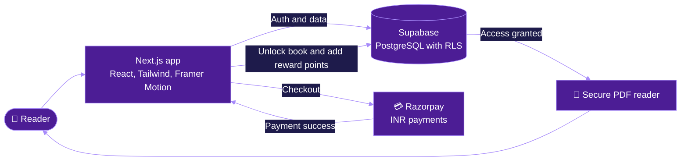
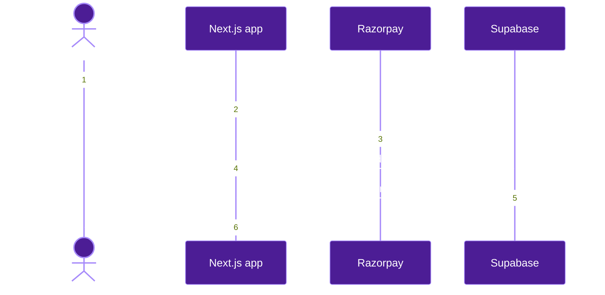

<!--
  VEDOXA README (v2)
  GitHub strips <script> and <style>, so all motion comes from self-looping SVG images
  (capsule-render and readme-typing-svg) plus GitHub-native features (Mermaid, <details>).

  Quick edits
    - Typing lines  -> `lines=` in each typing  (split with ; and use + for spaces)
    - Colours       -> `color=timeGradient` follows the time of day; pin one with e.g. color=6D28D9
    - Header text   -> `text=` and `desc=` in the first 
    - Placeholders  -> search this file for YOUR_ and replace them
    - Extras        -> see the OPTIONAL comment near the bottom
-->

<a name="top"></a>

<div align="center">

<!-- Hero: waving banner, fades in and keeps rolling -->


<!-- Typing line: cycles through the messages forever -->
<a href="https://vedoxa.shop">
  
</a>

<br />

<!-- Badges: the status badge checks the live site every time the page loads -->
<a href="https://vedoxa.shop"></a>
<a href="https://vedoxa.shop"></a>


<br /><br />

<!-- Quick navigation -->
<p align="center">
  <a href="#features"><b>Features</b></a> &nbsp;|&nbsp;
  <a href="#how-it-works"><b>How it works</b></a> &nbsp;|&nbsp;
  <a href="#tech"><b>Tech stack</b></a> &nbsp;|&nbsp;
  <a href="#architecture"><b>Architecture</b></a> &nbsp;|&nbsp;
  <a href="#roadmap"><b>Roadmap</b></a> &nbsp;|&nbsp;
  <a href="#faq"><b>FAQ</b></a> &nbsp;|&nbsp;
  <a href="#developers"><b>For developers</b></a>
</p>

</div>

<p align="center">
  Welcome to the official repository of <b>VEDOXA</b>, a premium platform built to awaken your
  consciousness with 100% original, verified digital books on spirituality &amp; psychology.
</p>

<table align="center">
  <tr>
    <td align="center" width="25%"><h2>💯</h2><b>100% original</b><br /><sub>Every book is verified</sub></td>
    <td align="center" width="25%"><h2>⚡</h2><b>Instant unlock</b><br /><sub>Read the moment payment succeeds</sub></td>
    <td align="center" width="25%"><h2>🔐</h2><b>Anti-piracy reader</b><br /><sub>Content stays protected</sub></td>
    <td align="center" width="25%"><h2>🎁</h2><b>Earn rewards</b><br /><sub>Points on every purchase</sub></td>
  </tr>
</table>


<a name="features"></a>
<h2 align="center">✨ Key features</h2>
<p align="center"><i>Everything a modern reader needs, and nothing they don't.</i></p>

<table>
  <tr>
    <td width="50%" valign="top">
      <h3>🔓 Instant secure access</h3>
      Zero waiting. Books unlock instantly after a successful payment.
    </td>
    <td width="50%" valign="top">
      <h3>📖 Premium web reader</h3>
      A secure, anti-piracy embedded PDF reader for a smooth reading experience.
      Zooming and downloading are disabled to protect content integrity.
    </td>
  </tr>
  <tr>
    <td width="50%" valign="top">
      <h3>🤖 Automated help &amp; support</h3>
      A floating help bot answers customer FAQs and runs an automated ticketing system.
    </td>
    <td width="50%" valign="top">
      <h3>🔗 Native web share</h3>
      Built-in sharing for quick link distribution across WhatsApp, Instagram, Telegram and more.
    </td>
  </tr>
  <tr>
    <td width="50%" valign="top">
      <h3>🎁 Dynamic reward system</h3>
      Earn points on every purchase and redeem them instantly at your next checkout.
    </td>
    <td width="50%" valign="top">
      <h3>💳 Seamless INR payments</h3>
      Fast, secure checkout in Indian rupees, powered by Razorpay.
    </td>
  </tr>
</table>


<a name="how-it-works"></a>
<h2 align="center">🧭 How it works</h2>
<p align="center"><i>From first look to last page in four steps.</i></p>

<table align="center">
  <tr>
    <td align="center" width="25%"><h2>🔎</h2><b>1. Discover</b><br /><sub>Browse verified titles in Spirituality &amp; Psychology</sub></td>
    <td align="center" width="25%"><h2>💳</h2><b>2. Pay securely</b><br /><sub>Check out in INR through Razorpay</sub></td>
    <td align="center" width="25%"><h2>🔓</h2><b>3. Unlock instantly</b><br /><sub>Access appears as soon as payment succeeds</sub></td>
    <td align="center" width="25%"><h2>🪷</h2><b>4. Read and earn</b><br /><sub>Read in the secure reader and collect reward points</sub></td>
  </tr>
</table>


<a name="tech"></a>
<h2 align="center">🛠️ Tech stack</h2>

<p align="center">
  This project is built with modern, highly scalable technologies.
</p>

<p align="center">
  <a href="https://skillicons.dev">
    
  </a>
</p>

<table align="center">
  <tr>
    <td><b>Frontend</b></td>
    <td>Next.js (React), TypeScript, Tailwind CSS, Framer Motion for smooth animations</td>
  </tr>
  <tr>
    <td><b>Backend &amp; database</b></td>
    <td>Supabase (PostgreSQL, Authentication, Storage)</td>
  </tr>
  <tr>
    <td><b>Payment gateway</b></td>
    <td>Razorpay (seamless &amp; secure INR transactions)</td>
  </tr>
  <tr>
    <td><b>Icons &amp; UI elements</b></td>
    <td>Lucide React</td>
  </tr>
  <tr>
    <td><b>Deployment</b></td>
    <td>Vercel</td>
  </tr>
</table>


<a name="architecture"></a>
<h2 align="center">🧩 Architecture</h2>
<p align="center"><i>A simplified view of how the pieces connect.</i></p>



<details>
<summary><b>See the purchase flow step by step</b></summary>



</details>


<h2 align="center">🚀 Performance &amp; security</h2>

<table>
  <tr>
    <td width="25%" valign="top" align="center">
      <h3>📱 Mobile first</h3>
      Fully responsive and optimized for mobile devices.
    </td>
    <td width="25%" valign="top" align="center">
      <h3>🎯 App-like feel</h3>
      Native touch-zooming is prevented to keep the UI consistent.
    </td>
    <td width="25%" valign="top" align="center">
      <h3>🔐 Data protection</h3>
      Environment variables and Row Level Security (RLS) implemented via Supabase.
    </td>
    <td width="25%" valign="top" align="center">
      <h3>🛡️ Secure payments</h3>
      Transactions are processed by Razorpay, a dedicated payment gateway.
    </td>
  </tr>
</table>


<a name="roadmap"></a>
<h2 align="center">🗺️ Roadmap</h2>
<p align="center"><i>What is live today, and what could come next.</i></p>

**Live now**

- [x] Instant unlock after payment
- [x] Secure embedded PDF reader (no zooming or downloading)
- [x] Floating help bot with automated ticketing
- [x] Native web share
- [x] Reward points on every purchase

**Ideas under consideration**

- [ ] 🔖 Reading progress and bookmarks
- [ ] 🌐 Hindi and multi-language interface
- [ ] 🎧 Audio summaries
- [ ] 📲 Installable app experience (PWA)
- [ ] 💝 Wishlist and referral rewards


<a name="faq"></a>
<h2 align="center">❓ FAQ</h2>

<details>
<summary><b>Can I download the books?</b></summary>
<br />
No. To protect authors and content integrity, books are read inside VEDOXA's secure web reader, where downloading and zooming are disabled.
</details>

<details>
<summary><b>How fast do I get access after paying?</b></summary>
<br />
Instantly. The book unlocks as soon as your payment succeeds.
</details>

<details>
<summary><b>How do reward points work?</b></summary>
<br />
You earn points on every purchase and can redeem them at your next checkout.
</details>

<details>
<summary><b>Which payment methods can I use?</b></summary>
<br />
Checkout is powered by Razorpay in INR. The available payment methods are shown at checkout.
</details>

<details>
<summary><b>I need help. What should I do?</b></summary>
<br />
Tap the floating help bot on the website. It answers common questions and can raise a support ticket for you.
</details>


<a name="developers"></a>
<h2 align="center">👩‍💻 For developers</h2>

<details>
<summary><b>Run the project locally</b></summary>

<br />

```bash
git clone https://github.com/YOUR_USERNAME/YOUR_REPO.git
cd YOUR_REPO
npm install
npm run dev
```

Create a `.env.local` file in the project root. The names below are examples, so match them to your project:

```env
NEXT_PUBLIC_SUPABASE_URL=
NEXT_PUBLIC_SUPABASE_ANON_KEY=
SUPABASE_SERVICE_ROLE_KEY=
NEXT_PUBLIC_RAZORPAY_KEY_ID=
RAZORPAY_KEY_SECRET=
```

Keep the service-role key and the Razorpay secret on the server only, and never commit `.env` files.

</details>


<h2 align="center">🪷 Wisdom to wander with</h2>

<p align="center">
  
</p>

<h2 align="center">💜 Connect</h2>

<p align="center">
  <a href="https://vedoxa.shop"></a>
  <!-- OPTIONAL: social badges, un-comment and replace the YOUR_ values
  <a href="https://instagram.com/YOUR_HANDLE"></a>
  <a href="https://t.me/YOUR_CHANNEL"></a>
  <a href="mailto:YOUR_EMAIL"></a>
  -->
</p>

<p align="center">
  Need help? Use the help bot on <a href="https://vedoxa.shop">vedoxa.shop</a>.
</p>

<!--
  OPTIONAL extras (un-comment and replace YOUR_USERNAME / YOUR_REPO)

  Repo badges, add them under the main badges at the top:
  
  

  Screenshots, put the images in an /assets folder and add a section after "How it works":
  <p align="center">
    
    
  </p>
-->

<!-- Footer: mirrors the header, twinkling text -->


<p align="center">
  <a href="#top">Back to top ↑</a>
</p>

<p align="center">
  <sub>© <b>VEDOXA</b> Premium Library</sub>
</p>
